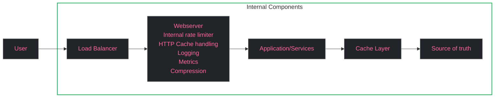
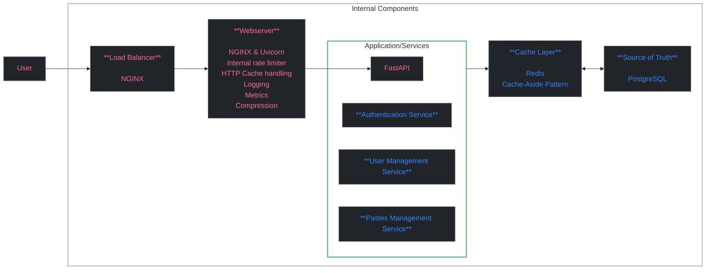

## High Level Architecture
Incoming requests pass directly to the internal web server, which handles cross-cutting concerns such as rate limiting, HTTP caching, logging, metrics, compression, and load balancing. The application layer encapsulates the core business logic and services, keeping infrastructure concerns separate from application responsibilities.
A dedicated cache layer improves read performance, while the primary data store remains the **source of truth** for persistent data. This separation promotes clear responsibility boundaries, efficient data access, and a foundation for future scalability.

## Detailed Architecture
NGINX acts as the load balancer, distributing incoming traffic to the web server layer, where NGINX and Uvicorn handle request routing and infrastructure concerns such as internal rate limiting, HTTP caching, logging, metrics, and compression. The application layer is built with FastAPI and separates authentication, user management, and paste management into dedicated services.
Redis provides a cache layer using the **Cache-Aside Pattern**, reducing database reads for frequently accessed data, while PostgreSQL serves as the **source of truth** for persistent data. This design separates application responsibilities from infrastructure concerns and establishes clear boundaries between caching and durable storage.
